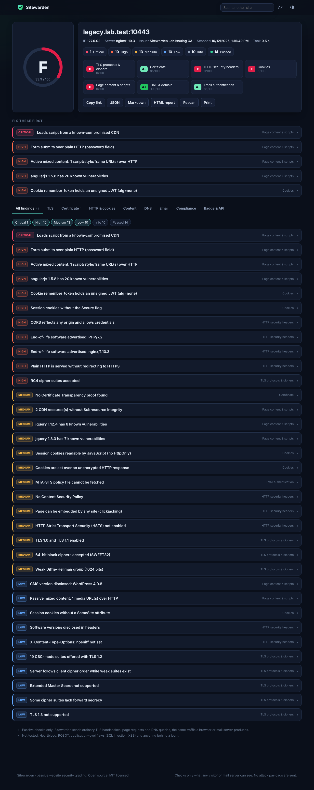

# Sitewarden

**Passive website security grading.** Enter a domain and get an A+ to F grade covering TLS, certificates, HTTP security headers, cookies, page content, DNSSEC and email spoofing protection. Every finding comes with evidence, an explanation and copy-paste fixes for nginx, Apache, Caddy and more.



It ships as a **CLI**, a **self-hostable web app** with a JSON API and README badges, a **GitHub Action** and a **Docker image**.

```
$ sitewarden scan example.com

  Sitewarden 1.0.0  ·  example.com  (93.184.215.14)

  Grade   B    score 81.2/100   scanned in 6.3s

  TLS protocols & ciphers      A+ ████████████████████ 100
  Certificate                  A+ ████████████████████ 100
  HTTP security headers        D  ███████████░░░░░░░░░  55
  ...
  [HIGH] Plain HTTP is served without redirecting to HTTPS  headers
         Fix: Redirect every http:// request with a 301 to https://
```

## Why it's different

Most "header checkers" fetch one page and look for five headers. Sitewarden does the work of several specialist tools in one passive scan:

| Area | What is checked |
|---|---|
| **TLS** (own handshake engine) | Hand-built ClientHellos enumerate SSL 2.0 to TLS 1.3, every cipher suite (226 known) and the server's preference order, key exchange groups through HelloRetryRequest, **post-quantum X25519MLKEM768**, DH parameter size (Logjam), RC4, 3DES/SWEET32, CBC, export and NULL suites, TLS_FALLBACK_SCSV, the TLS 1.3 downgrade sentinel, secure renegotiation, compression (CRIME), Extended Master Secret, heartbeat, SNI requirement. |
| **Certificates** | Path validation against the Mozilla root store, incomplete chains (fetched through AIA like browsers do), hostname coverage, expiry, key strength, SHA-1, OCSP and CRL revocation, OCSP stapling, Must-Staple, Certificate Transparency SCTs, the CA/B Forum 398-day limit. Separate chains for ECDSA and RSA certificates. |
| **HTTP headers** | HTTPS redirects (every hop), HSTS and its preload status against the bundled Chromium list, a **CSP evaluator** based on Google's strict-CSP research (unsafe-inline, wildcards, known bypassable hosts such as JSONP endpoints, missing `object-src`/`base-uri`, static nonces detected by loading the page twice), CORS origin reflection with credentials, clickjacking, nosniff, Referrer-Policy, Permissions-Policy, COOP/COEP/CORP, end-of-life server software banners, `security.txt` (RFC 9116). |
| **Cookies** | Secure, HttpOnly and SameSite on session cookies, `__Host-`/`__Secure-` prefix rules, cookies set over plain HTTP, very long lifetimes, unsigned JWTs (`alg=none`) in cookies. |
| **Page content** | Active and passive mixed content, forms posting to HTTP, scripts from **known-compromised CDNs** (polyfill.io and similar), missing Subresource Integrity on third-party scripts, **vulnerable JavaScript libraries** detected from URLs and file contents with the Retire.js database, CMS version disclosure. |
| **DNS** | **Full DNSSEC chain validation from the IANA root trust anchor** (secure, insecure, bogus, island of security), weak DNSSEC algorithms, CAA records **cross-checked against the CA that actually issued the certificate**, **dangling CNAMEs** pointing at deprovisioned cloud services (subdomain takeover), name server network diversity, IPv6. |
| **Email** | SPF with the RFC 7208 10-lookup and void-lookup limits, DMARC policy, alignment and external report authorisation, DKIM selector discovery and key size, MTA-STS (policy fetched over verified HTTPS and matched against the MX hosts), TLS-RPT, BIMI, null MX, STARTTLS and certificate checks on the mail servers, DANE TLSA. |
| **Compliance** | Mozilla Modern and Intermediate server-side TLS profiles (v6.0), NIST SP 800-52r2, PCI DSS 4.0 transport rules, OWASP secure headers, Google/Yahoo bulk-sender requirements. |

## Quick start

```bash
pip install .                 # Python 3.11+
sitewarden scan example.com
sitewarden scan https://example.com --html report.html --json report.json
sitewarden scan example.com --fail-under B   # exit code 1 below B, for CI
```

Web app:

```bash
pip install ".[web]"
sitewarden serve --host 0.0.0.0 --port 8080
# or
docker compose up -d          # http://localhost:8080
```

Useful CLI options: `--port 8443`, `--no-email`, `--no-smtp` (port 25 is often blocked on home and cloud networks), `--no-revocation`, `--dns 1.1.1.1`, `--resolve host:ip`, `--ca-file internal-root.pem` with `--allow-private` for internal sites, `-v` to list passed checks too. `sitewarden update` refreshes the HSTS preload list, Retire.js database, Public Suffix List and Mozilla guidelines.

### GitHub Action

```yaml
- uses: your-org/sitewarden@v1
  with:
    target: www.example.com
    fail-under: A-
```

The Markdown report is added to the job summary, and `grade` and `score` are step outputs.

### API and badges

```
POST /api/scans              {"target": "example.com", "hidden": false}   -> {"id": ...}
GET  /api/scans/{id}         status, live progress and the full report
GET  /api/scans/{id}/events  server-sent events while the scan runs
GET  /api/scans/{id}/report.json | .md | .html
GET  /badge/example.com.svg  latest grade as an SVG badge
GET  /api/docs               OpenAPI documentation
```

## How grading works

Each category starts at 100 and loses points per finding: critical 60, high 30, medium 15, low 5. The overall score is a weighted average (TLS 22, certificate 20, headers 22, content 10, email 10, cookies 8, DNS 8), mapped to a letter: A+ ≥ 95, A ≥ 90, A- ≥ 85, B ≥ 75, C ≥ 65, D ≥ 55, E ≥ 45, F below.

Some problems cap the grade whatever the score. An untrusted, expired or wrong-host certificate, SSL 2.0, export or NULL ciphers, a bogus DNSSEC chain, a dangling CNAME to a cloud provider, a password form posting over HTTP or a script from a compromised CDN mean F. SSL 3.0, RC4, SHA-1 signatures and an SPF `+all` cap the grade at C, and TLS 1.0/1.1, missing forward secrecy or insecure session cookies cap it at B. A+ needs a score of 95 or more **and** no medium-or-worse finding anywhere. Categories that were skipped (for example `--no-email`) are left out of the average.

## Architecture

```
sitewarden/
  tls/wire.py          TLS record and handshake encoder/decoder (ClientHello, ServerHello, HRR, certificates, SKE)
  tls/scanner.py       protocol, cipher, group and feature enumeration over many parallel handshakes
  tls/certificate.py   path validation (cryptography.x509.verification), AIA, OCSP, CRL, SCTs
  tls/analysis.py      TLS findings and Mozilla profile compliance
  http/client.py       HTTP client that only connects to vetted, pinned addresses
  http/headers.py csp.py cookies.py content.py jslibs.py wellknown.py
  dns/dnssec.py        DNSSEC validator from the root anchors (KSK-2017 and KSK-2024)
  dns/domain.py        CAA, takeover, NS, MX/STARTTLS/DANE
  dns/email.py         SPF, DMARC, DKIM, MTA-STS, TLS-RPT, BIMI
  scan.py              runs the TLS, HTTP and DNS phases in parallel and builds the report
  scoring.py           grades, caps and compliance
  remediation.py       configuration snippets per fix
  web/                 FastAPI app and a dependency-free JavaScript UI
lab/                   test range: test PKI, a DNSSEC-signing DNS server, nginx 1.10 and current nginx in Docker
tests/                 unit, integration and end-to-end tests
```

Runtime dependencies are only `cryptography`, `dnspython` and `certifi` (plus FastAPI and uvicorn for the web app).

## Safe by design

- **Passive only.** Sitewarden sends what a browser or mail server would: TLS handshakes, a few GET requests, DNS queries and an SMTP `EHLO`/`STARTTLS`. No exploit payloads, no fuzzing, no login attempts. Heartbleed, ROBOT and application flaws such as SQL injection or XSS are deliberately out of scope.
- **SSRF-safe for public hosting.** Every name is resolved once, private and reserved addresses are refused, and connections are pinned to the vetted address, including redirects, AIA, OCSP, CRL, MTA-STS and mail server lookups.
- **The web app practises what it checks:** a strict CSP with Trusted Types and no inline code, HSTS, cross-origin isolation, rate limiting, result caching and a port-443-only public scanner. See [SECURITY.md](SECURITY.md).

## Testing

```bash
pip install -e ".[dev]"
pytest                        # 83 tests; the Docker range test is skipped without Docker
python -m lab.range scan      # real nginx servers, writes lab/results/*.json and *.html
python -m lab.demo            # the web UI against the lab, at http://127.0.0.1:8000
```

The test range runs without internet access:

- a throwaway PKI (root, intermediate, and modern, expired, wrong-host, self-signed, incomplete-chain and SHA-1 leaf certificates),
- a DNS server that signs zones on the fly with real DNSSEC (a signed lab root, a secure domain, an unsigned one, one with a broken signature and an island of security), with good and bad SPF/DMARC/DKIM records and a dangling CNAME,
- **nginx 1.10 with OpenSSL 1.0.1** (TLS 1.0, RC4, 3DES, 1024-bit DH, permissive CORS, a vulnerable page) and **current nginx with OpenSSL 3.5** (TLS 1.3, dual ECDSA/RSA certificates, X25519MLKEM768, per-request CSP nonces).

Expected results: the modern server grades A with post-quantum key exchange detected, the legacy server grades F, and every certificate fault is reported.

## Limitations

- Results describe what is visible from the scanner's network location; CDNs and geo-routing can serve other clients differently.
- Port 25 is blocked on many networks; use `--no-smtp` there.
- DKIM selectors cannot be listed through DNS, so Sitewarden probes 52 common selectors. A missing DKIM result is reported as "not found", not as a failure.
- Library detection relies on the Retire.js database and on scripts the page references directly.

## Licence

MIT. Bundled data keeps its own licence (Chromium HSTS list, Public Suffix List, Mozilla guidelines, Retire.js): see [THIRD_PARTY.md](THIRD_PARTY.md).
